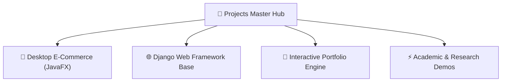

# 🚀 Projects Portfolio Hub — Multi-Tier Engineering Works

  <b>A flagship consolidation repository aggregating practical software engineering, web architectures, desktop applications, and academic projects.</b>

---

## 📌 Project Matrix

| Project | Primary Stack | Core Highlights |
| :--- | :--- | :--- |
| **Online Store Application** | JavaFX, Java, CSS | Desktop GUI with product catalog, role-based admin/customer controls, and cart billing. |
| **Django Base Architecture** | Python, Django, SQLite | Production-ready web scaffolding with authentication, modular applications, and dynamic views. |
| **Personal Showcase (Port)** | HTML5, CSS3, JavaScript | Interactive web portfolio interface. |

---

## 🏛️ Integrated Ecosystem

---

## 👨‍💻 Author

**Momin Rifat**  
GitHub: [@MominRifat](https://github.com/MominRifat)  
Location: Dhaka, Bangladesh
